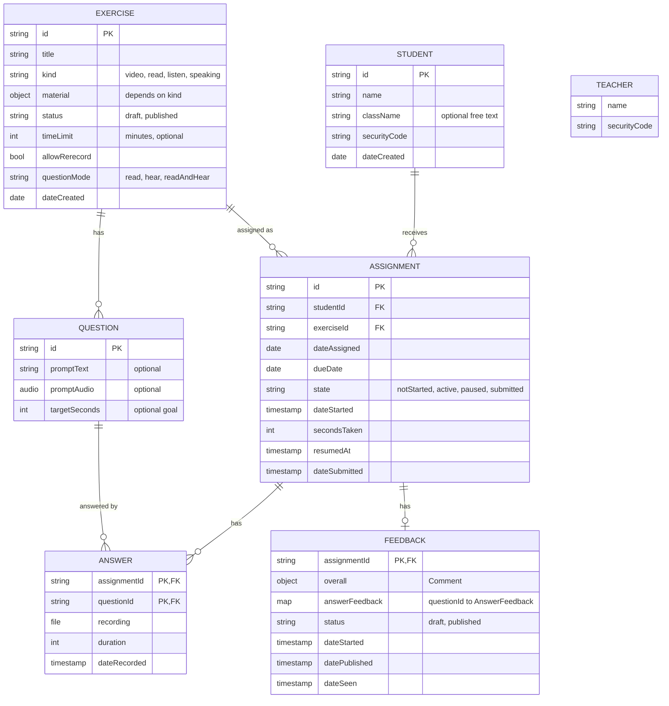

# Data model

## Diagram



Questions are embedded in their exercise (see Question below), so they have no `exerciseId` or `order` field: the parent is the exercise and the order is the array order. An exercise can have zero questions while it is a draft; it needs at least one to publish.

Types: `date` is a calendar day (`YYYY-MM-DD`). `timestamp` is a point in time (ISO 8601 in the prototype, a Firestore Timestamp later). The timer needs real timestamps. `audio` is a teacher recording: `{ path, duration }`, the file path and its length in seconds (the length is shown as "0:02 / 2:42" and on settings rows). A student's Answer keeps its own `recording` and `duration` fields.

## Entities

### Teacher
One for now (`Db.teacher`). Signs in with a code, like a student.

- `name`, `securityCode`

### Student
- `id`, `name`, `className?`, `securityCode`, `dateCreated`
- `className`: optional free text that groups students (e.g. "Aleph"). There is no Class entity: the classes are the distinct values in use, and a class exists only while some student has it. When set, the value is trimmed, blank means no class, and a value that matches an existing class ignoring case takes that class's spelling. Renaming a class means changing it on each of its students.
- `name`: required, and unique across all students (ignoring case and surrounding spaces).
- `securityCode`: a code like `AZ54-93GW` (8 characters without look-alikes such as 0/O and 1/I), generated automatically, that the student signs in with. Typed codes match ignoring case, spaces and dashes. The teacher can show it or generate a new one. Codes are unique across all students and the teacher; a generated code that collides is regenerated.

### Exercise
The template. One structure for every kind: the material varies, and the questions work the same way.

- `id`, `title`, `kind`, `material`, `status`, `timeLimit?`, `allowRerecord`, `questionMode`, `dateCreated`, `questions[]` (one or more to publish)
- `kind` and its `material`:

| kind | Label | Material |
|---|---|---|
| `video` | Video | `url` (YouTube), `start?`, `end?`. Blank start means the beginning; blank end means the end. |
| `read` | Read and respond | `text` |
| `listen` | Listen and respond | `audio` (an `audio` recording by the teacher, always played whole) |
| `speaking` | Speaking questions | none |

- A draft can have incomplete material: an empty `url` or `text`, or no `audio`. Publishing requires them.
- `timeLimit`: for the whole exercise, and soft: a guide shown to the student, never a cutoff (the clock keeps going past it). One value on the exercise, with no per-assignment override. To get a different limit, duplicate the exercise.
- `questionMode`: how students get each question. `read`: they read the text. `hear`: they only hear the audio (listening practice, or simulating the exam); the text is for the teacher. `readAndHear`: both. In `hear` and `readAndHear`, publishing requires audio on every question; in `read`, question audio isn't used.
- `allowRerecord`: if true, a student can re-record an answer before submitting, which overwrites it. If false, it's one take, like the real exam.

**Lifecycle:** `draft` is fully editable. `published` is **locked**, and only published exercises can be assigned. To change a published exercise, **Duplicate** it, which creates a new draft. Locking guarantees that students' answers always match the questions they answered.

### Question
- `id`, `promptText?`, `promptAudio?`. `promptText` is the question itself and is required to publish: the teacher always grades against it. `promptAudio` is the spoken version: required when `questionMode` is `hear` or `readAndHear`, not used in `read`. A draft question can have neither while the teacher fills it in.
- `targetSeconds?`: a goal for the answer's length, not a cutoff. The student can record longer and sees that they went over.
- Stored inside its Exercise, in order; safe to embed because a published exercise never changes.

### Assignment
One exercise given to one student. It also holds the student's progress (there is no separate "work" or "submission" record, because there is exactly one response per assignment).

- `id`, `studentId`, `exerciseId`, `dateAssigned`, `dueDate?` (absent means no due date)
- `state`: `notStarted` → `active` ⇄ `paused` → `submitted`
- Timer:
  - `dateStarted`: set once, when the student first taps Start.
  - `secondsTaken`: time accumulated over finished sessions.
  - `resumedAt`: when the current session began. Empty while paused or submitted.
  - Time taken right now = `secondsTaken` + (now − `resumedAt`) while `active`.
- `dateSubmitted`
- A student can get the same exercise again (a repeat, e.g. an oral project every couple of weeks), each time as a new Assignment with its own answers and feedback. Rule: **at most one open (not submitted) assignment per student + exercise**. The UI enforces it (Assign blocks the student, `assign()` skips them); the data doesn't need to.

### Answer
- Key: `assignmentId` + `questionId`, so there is at most one answer per question per assignment. Re-recording overwrites it.
- `recording` (audio file), `duration` (seconds), `dateRecorded`
- "Over target" means `duration` > the question's `targetSeconds`.

### Feedback
Zero or one per assignment; it exists once the teacher starts reviewing.

- `Comment` = `{ text?, audio? }` (`audio` is an `audio` recording), with at least one of the two to count as a comment. A comment left with neither is removed.
- `overall: Comment`, on the whole assignment.
- `answerFeedback: { [questionId]: AnswerFeedback }`, keyed by the same questionId as the Answer. Present only when it has something in it.
  - `AnswerFeedback` = `{ comments: TimedComment[], overall: Comment, dateSeen? }`: comments anchored to moments in the answer, plus one overall comment on the whole answer (not tied to a moment). `dateSeen`: when the student first opened them; absent shows `Unread` to the student.
  - `TimedComment` = `Comment` + `{ id, atSeconds }`. `atSeconds` is where in the answer the teacher paused to comment. Kept sorted by `atSeconds`, and numbered in that order for display ("Comment 1…n"), so numbers aren't stored.
- `status`: `draft` | `published`. A single status for the whole thing: the student sees **nothing**, overall or per answer, until it is published. Once published it stays published and cannot go back to draft: later edits reach the student right away and update `datePublished`. Each comment is saved as the teacher makes it; the first one creates the Feedback as a draft, and a draft whose comments are all removed is deleted (back to Needs review).
- `dateStarted`, `datePublished`
- `dateSeen`: when the student first opened the published feedback. Absent means it's new to them ("New feedback" on their Home).
- Grades: not included yet. If needed later, add an optional `grade` to the overall `Comment`s (per answer and per assignment).
- Later, for the student screen: whether the student has heard each comment (per comment, stored on the student side).

## Display status of an assignment (derived, not stored)

| Status | Condition |
|---|---|
| Not started | `state = notStarted` |
| In progress | `state = active` |
| Paused | `state = paused` |
| Needs review | `state = submitted`, no Feedback |
| Feedback draft | `state = submitted`, Feedback is `draft` |
| Done | `state = submitted`, Feedback is `published` |

Lists of assignments are one flat list in "needs you first" order: Needs review (waited longest first), Feedback draft, overdue, the other unfinished ones by due date (nearest first, none last), then Done (most recent first). Each row shows its status as a badge.

## Planned Firestore layout (real app, not the prototype)

```
students/{studentId}                     name, className, securityCode, dateCreated
exercises/{exerciseId}                   ...fields, material, questions[] embedded
assignments/{assignmentId}               studentId, exerciseId, dueDate, state, timer fields
                                         + copied studentName, exerciseTitle (for lists)
assignments/{id}/answers/{questionId}    audioPath, duration, dateRecorded
assignments/{id}/feedback/main           overall, answerFeedback, status, dates
```

- Copying the exercise title and student name onto assignments is safe because published exercises never change. (A student rename would need to update its assignments.)
- Feedback is a separate record so security rules can let a student read it only when `status == published`.
- Audio files go in Cloud Storage; records store the file paths.
- Auth: anonymous Firebase auth. Signing in with a code links the anonymous user to the teacher or one student; signing out drops that link, so the code is needed again.
